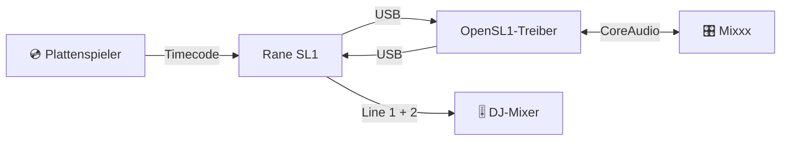

<div align="center">

# 🎛️ OpenSL1

## Der fehlende macOS-Treiber für die Rane SL1

**Hol deine Serato-Scratch-Live-Box auf Apple Silicon zurück – und scratche Timecode-Vinyl in Mixxx.**

   

<a href="https://github.com/OnSerious/OpenSL1/releases/latest"></a> <a href="https://github.com/OnSerious/OpenSL1/actions/workflows/build.yml"></a> <a href="LICENSE"></a> 

### [⬇️ Installer herunterladen](https://github.com/OnSerious/OpenSL1/releases/latest)

</div>

<p align="center">
🇺🇸 <a href="./README.md">English</a> | 🇩🇪 <a href="./README.de.md">Deutsch</a>
</p>

---

<details open>
<summary><b>📑 Inhalt</b></summary>

- [Warum OpenSL1?](#-warum-opensl1)
- [Funktionen](#-funktionen)
- [So funktioniert's](#-so-funktionierts)
- [Voraussetzungen](#-voraussetzungen)
- [Installation](#-installation)
- [Mixxx einrichten](#mixxx-einrichten)
- [Checkliste für Auftritte](#-checkliste-für-auftritte)
- [Messwerte](#-messwerte)
- [FAQ](#-faq)
- [Fehlersuche](#-fehlersuche)
- [Roadmap](#-roadmap)
- [Mitmachen](#-mitmachen)
- [Lizenz & Hinweis](#-lizenz--hinweis)

</details>

## 💡 Warum OpenSL1?

> [!NOTE]
> **Welche Box ist gemeint?** Das ursprüngliche Rane-Interface für **Serato Scratch Live** von 2004 – eine kleine Box
> mit Input 1/2, Thru- und Line-Buchsen für zwei Decks. Draufgestanden hat einfach „Serato Scratch Live“; den Namen
> **SL1** bekam sie erst später, als SL2 und SL3 erschienen. Am USB meldet sie sich als `Serato Scratch LIVE(c)2004`
> (`13e5:0001`).

Deine SL1 funktioniert noch. Die Software dazu nicht mehr: Serato Scratch Live ist 32-Bit-Intel-Software, und Macs mit
Apple Silicon können sie nicht ausführen – auch nicht über Rosetta. Serato DJ hat die SL1 nie unterstützt.

**OpenSL1 ist ein nativer macOS-Audiotreiber für die SL1.** Installieren, Box anstecken – sie erscheint als ganz
normale Soundkarte **„Rane SL1“**, bereit für [Mixxx](https://mixxx.org), die kostenlose DJ-Software, die Serato-
Timecode-Vinyl liest.

> [!NOTE]
> OpenSL1 ist ein unabhängiges Open-Source-Projekt. Es stammt **nicht** von Rane, Serato oder inMusic, wird von ihnen
> nicht unterstützt und enthält keinen Code von ihnen.

## ✨ Funktionen

| | |
|---|---|
| 🎧 **Anstecken & loslegen** | „Rane SL1“ mit 4 Eingängen (Input 1/2) und 4 Ausgängen (Line 1/2) bei 44,1 kHz |
| 💿 **Timecode auf beiden Decks** | Serato-CV02-Vinyl in Mixxx, getestet mit echten Plattenspielern und DJ-Mixer |
| 🔌 **Gebaut für Missgeschicke** | Kabel mitten im Set rausgerutscht? Wieder einstecken – in *irgendeinen* Port – die Musik kommt von selbst zurück |
| 😴 **Ruhezustand-fest** | Deckel zu, Deckel auf – 45 ms nach dem Aufwachen ist der Ton wieder da |
| ⚡ **Schnelle Hardware-Strecke** | 2,9 ms durch USB und Wandler |
| 🩺 **Diagnose für Auftritte** | Pegel, Lücken, USB-Fehler und Strom-Ereignisse im macOS-Log – du siehst, was im Set passiert ist |
| 🛡️ **Sicher gebaut** | Keine Kernel-Erweiterung; läuft in der Sandbox von Apples Audiodienst und wird nie zur Systemausgabe |
| 🍏 **Universal** | Ein Installer für Apple Silicon und Intel, ab macOS 12 Monterey |

## 🔊 So funktioniert's

<!-- Experimentell: falls das Diagramm nicht angezeigt wird, auf GitHub ansehen -->


Im Inneren ist die SL1 ein USB-Audio-Interface: OpenSL1 überträgt Ein- und Ausgänge direkt per USB und stellt sie
macOS als CoreAudio-Gerät bereit. Der Takt kommt von der SL1 selbst – nichts driftet.

## 📋 Voraussetzungen

| | |
|---|---|
| 💻 Mac | Apple Silicon (ab M1) oder Intel |
| 🍏 macOS | ab 12 Monterey |
| 🎛️ Interface | Rane SL1 |
| 🎚️ DJ-Software | [Mixxx](https://mixxx.org) (kostenlos) |
| 💿 Timecode-Vinyl | Serato CV02 (Side A, 33⅓) |

## 📦 Installation

1. **`OpenSL1-0.1.0.pkg`** vom [aktuellen Release](https://github.com/OnSerious/OpenSL1/releases/latest) laden.
2. Doppelklicken und dem Installer folgen.
3. SL1 anstecken – fertig. Sie erscheint als **„Rane SL1“** im *Audio-MIDI-Setup* und in Mixxx.

> [!IMPORTANT]
> Der Installer ist nicht von Apple notariell beglaubigt (freies Hobbyprojekt ohne bezahltes Entwicklerkonto).
> Wenn macOS ihn nicht öffnet: **Systemeinstellungen → Datenschutz & Sicherheit → Trotzdem öffnen**.

<details>
<summary><b>🗑️ Deinstallieren</b></summary>

**`OpenSL1-Uninstall-0.1.0.pkg`** aus demselben Release öffnen. Das war's.
</details>

## Mixxx einrichten

| Wo | Einstellung |
|---|---|
| macOS fragt „Mixxx möchte auf das Mikrofon zugreifen“ | **Erlauben** – sonst kommt kein Timecode in Mixxx an |
| Einstellungen → Soundhardware | **CoreAudio**, **44100 Hz**, Puffer **5,8 ms** |
| Ausgang: Deck 1 / Deck 2 | „Rane SL1“ Kanäle **1–2** / **3–4** |
| Ausgang: Main, Kopfhörer | **Keine** – das macht dein DJ-Mixer |
| Eingang: Vinyl Control 1 / 2 | „Rane SL1“ Kanäle **1–2** / **3–4** |
| Einstellungen → Vinyl-Steuerung | **Serato CV02 Vinyl, Side A**, 33⅓, Modus **REL** |
| Vinyl-Steuerung → Filter | **Alpha-Beta** zum Scratchen |

> [!TIP]
> **Zum Scratchen ist Alpha-Beta besser als Kalman.** Mit dem Kalman-Filter läuft der Track nach einem Handstopp kurz
> in Zeitlupe weiter. Alpha-Beta stoppt sofort – nur die Tempoanzeige zappelt etwas, hören tust du das nicht.

> [!WARNING]
> **Die SL1 als einzige Soundkarte in Mixxx nutzen.** Gehen Main oder Kopfhörer auf die Mac-Lautsprecher oder ein
> anderes Interface, muss Mixxx zwei Uhren abgleichen – das kann knacken und springen.

## 🎤 Checkliste für Auftritte

- [ ] SL1 **vor** dem Start von Mixxx anstecken
- [ ] Ladekabel des Macs **vor** dem Set einstecken – und während des Sets nicht anfassen
- [ ] Main und Kopfhörer auf **Keine**, Puffer 5,8 ms, 44,1 kHz
- [ ] Nach dem Start von Mixxx ein paar Sekunden warten, bevor die Nadel aufsetzt
- [ ] Soundeinstellungen nicht während des Sets ändern
- [ ] Kabel rausgerutscht? **Mixxx laufen lassen** und die SL1 wieder einstecken – jeder Port geht

## 📊 Messwerte

Gemessen an einem MacBook Air M4 mit echtem Timecode:

| | |
|---|---|
| ⚡ Hardware-Schleife (USB + Wandler) | **2,9 ms** – in jedem Lauf gleich |
| 🎚️ Platte → Line-Ausgang (5,8 ms Puffer) | **≈ 35 ms** |
| 🔇 Rauschabstand der Eingänge | **≈ 41 dB** (Timecode −47 dBFS, Grundrauschen −88 dBFS) |
| ✅ 15 min Timecode auf beiden Decks | **917 434 Pakete pro Eingang, 0 Fehler** |
| 🔌 Neu einstecken während der Wiedergabe | Ton **0,3 s** nachdem macOS die SL1 erkennt |
| 😴 Aufwachen aus dem Ruhezustand | Ton **45 ms** nach dem Aufwachen |

## ❓ FAQ

<details>
<summary><b>Läuft die SL1 damit in Serato DJ?</b></summary>

Nein. Serato DJ hat die SL1 nie unterstützt, und OpenSL1 wird die SL1 nie als anderes Gerät ausgeben. Nimm Mixxx.
</details>

<details>
<summary><b>Geht sie auch mit anderen Programmen?</b></summary>

Die SL1 ist ein normales CoreAudio-Gerät, andere Programme sollten sie also als Soundkarte sehen. Timecode-Steuerung
ist nur mit Mixxx getestet.
</details>

<details>
<summary><b>Läuft es auf Intel-Macs?</b></summary>

Der Installer enthält einen Universal-Treiber (Apple Silicon + Intel). Getestet ist er bisher nur auf Apple Silicon –
Berichte von Intel-Macs sind willkommen.
</details>

<details>
<summary><b>Ist das sicher?</b></summary>

OpenSL1 ist ein Audio-Plug-in im Benutzerbereich, keine Kernel-Erweiterung. Es läuft in der Sandbox des macOS-
Audiodiensts und darf nur auf die SL1 zugreifen – keine Dateien, kein Netzwerk. Der komplette Quelltext liegt hier.
</details>

<details>
<summary><b>Und der Mikrofon-Eingang?</b></summary>

Noch nicht unterstützt.
</details>

<details>
<summary><b>Ich nutze Linux.</b></summary>

Dann brauchst du OpenSL1 nicht – Linux unterstützt die SL1 von Haus aus. Siehe
[docs/DEVELOPMENT.md](docs/DEVELOPMENT.md#linux).
</details>

## 🔧 Fehlersuche

<details>
<summary><b>Kein Gerät „Rane SL1“</b></summary>

Kabel prüfen, dann im Terminal den Audiodienst neu starten: `sudo killall coreaudiod`.
</details>

<details>
<summary><b>Ton bricht ab, wenn ich das Ladekabel des Macs ein- oder ausstecke</b></summary>

Die SL1 bekommt ihren Strom über USB und kann kurz abfallen, wenn der Mac zwischen Netzteil und Akku wechselt. Meist
fängt der Treiber das in etwa 3 Sekunden ab. Selten hängt die SL1 – dann ab- und wieder anstecken, Mixxx kann
weiterlaufen. Am besten: Ladekabel vor dem Set einstecken. Details in
[docs/MACOS.md](docs/MACOS.md#known-issue-the-sl1-drops-off-usb-when-the-macs-power-source-changes).
</details>

<details>
<summary><b>Mixxx wurde ohne SL1 gestartet und findet sie nicht</b></summary>

SL1 anstecken, dann in Mixxx *Einstellungen → Soundhardware* öffnen und **Anwenden** klicken (oder Mixxx neu starten).
</details>

<details>
<summary><b>Mixxx 2.6 Beta friert beim Übernehmen der Soundeinstellungen ein</b></summary>

Das ist ein Fehler in der Mixxx-Beta, nicht im Treiber (der läuft weiter). Mixxx sofort beenden, neu starten und den
Sound vor dem Set einrichten – oder eine stabile Mixxx-Version nutzen.
</details>

<details>
<summary><b>Was ist während meines Sets passiert?</b></summary>

Der Treiber schreibt alle 30 Sekunden einen kurzen Bericht. Im Terminal:

```bash
/usr/bin/log show --last 2h --predicate 'subsystem == "org.opensl1.driver"'
```
</details>

## 🧭 Roadmap

- [x] CoreAudio-Treiber mit Timecode auf beiden Decks
- [x] Übersteht Abziehen, Ruhezustand und USB-Aussetzer
- [x] Installer und Uninstaller
- [ ] „Rane SL1“ auch ohne angesteckte SL1 sichtbar lassen, damit Mixxx seine Einstellungen nie verliert
- [ ] Gemessene Latenz an Programme melden
- [ ] Notariell beglaubigter Installer
- [ ] Mikrofon-Eingang

## 🤝 Mitmachen

OpenSL1 auf einem anderen Mac oder macOS ausprobiert? **Mach ein Issue auf** mit Mac-Modell, macOS-Version und den
Log-Zeilen von oben – jeder Bericht hilft. Bauen aus dem Quelltext, Testwerkzeuge und Interna (englisch):
**[docs/DEVELOPMENT.md](docs/DEVELOPMENT.md)**.

OpenSL1 folgt einer strengen Clean-Room-Regel: kein Code, keine Binärdateien und keine Disassemblierung von Rane-
oder Serato-Software.

## 🙏 Danke

- [**OpenSL3**](https://github.com/mrbrainz/OpenSL3) von mrbrainz hat gezeigt, dass so ein Treiber für Rane-Hardware
  auf Apple Silicon funktioniert. OpenSL1 ist komplett neu geschrieben – es enthält keinen OpenSL3-Code –, aber
  mehrere Ideen für die Robustheit stammen aus dessen Changelog.
- [**Mixxx**](https://mixxx.org) und seine auf xwax basierende Vinyl-Steuerung machen das Ganze erst nützlich.

<details>
<summary><b>🧪 Getestet mit</b></summary>

| | |
|---|---|
| Mac | MacBook Air 13 Zoll, M4, 2025 (`Mac16,12`, 16 GB) |
| macOS | 27.0.1 (26A434) |
| Verbindung | passiver USB-A-auf-USB-C-Adapter |
| DJ-Software | Mixxx 2.6.0-beta |
| Vinyl / Mixer | Serato CV02, zwei Plattenspieler, Pioneer-Mixer |
</details>

## 📜 Lizenz & Hinweis

**GPL-3.0-or-later** – siehe [LICENSE](LICENSE).

Rane, SL1, Serato und Scratch Live sind Marken ihrer jeweiligen Inhaber und werden hier nur genannt, um die Hardware
zu bezeichnen, mit der dieser Treiber funktioniert. OpenSL1 ist nicht mit Rane, Serato oder inMusic verbunden und wird
von ihnen weder empfohlen noch unterstützt.

<div align="center">

**Für DJs, die ihr Equipment am Leben halten.** 🎛️💿

Hat OpenSL1 deine SL1 gerettet? Dann gib einen ⭐

</div>
