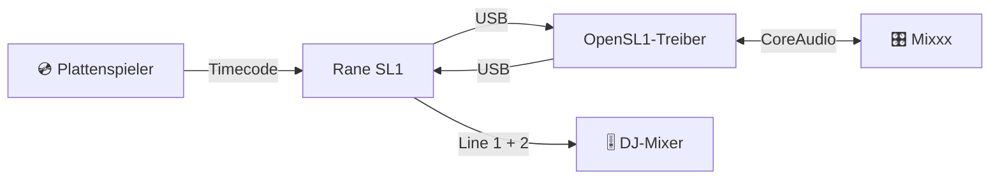

<div align="center">

# 🎛️ OpenSL1 – Inoffizieller Rane-SL1-Treiber (Serato Scratch Live) für macOS

## Kostenloser, inoffizieller Open-Source-Audiotreiber für die Rane SL1 auf dem Mac

**Nutze deine Rane SL1 (das Serato-Scratch-Live-Interface) wieder auf Macs mit Apple Silicon – scratche Serato-Timecode-Vinyl in Mixxx oder verwende die SL1 als Soundkarte in VirtualDJ.**

   

<a href="https://github.com/OnSerious/OpenSL1/releases/latest"></a> <a href="https://github.com/OnSerious/OpenSL1/actions/workflows/build.yml"></a> <a href="LICENSE"></a> 

### [⬇️ Installer herunterladen](https://github.com/OnSerious/OpenSL1/releases/latest)


<a href="https://ko-fi.com/OnSerious"></a>

</div>

<p align="center">
🇺🇸 <a href="./README.md">English</a> | 🇩🇪 <a href="./README.de.md">Deutsch</a>
</p>

---

<details open>
<summary><b>📑 Inhalt</b></summary>

- [Warum OpenSL1?](#-warum-opensl1)
- [Welche DJ-Software funktioniert?](#-welche-dj-software-funktioniert-mit-der-sl1-auf-macos)
- [Funktionen](#-funktionen)
- [So funktioniert's](#-so-funktionierts)
- [Voraussetzungen](#-voraussetzungen)
- [Installation](#-installation)
- [Mixxx einrichten](#mixxx-einrichten)
- [Checkliste für Auftritte](#-checkliste-für-auftritte)
- [Messwerte](#-messwerte)
- [FAQ](#-faq)
- [Fehlersuche](#-fehlersuche)
- [Roadmap](#-roadmap)
- [Mitmachen](#-mitmachen)
- [Lizenz & Hinweis](#-lizenz--hinweis)

</details>

## 💡 Warum OpenSL1?

> [!NOTE]
> **Welche Box ist gemeint?** Das ursprüngliche Rane-Interface für **Serato Scratch Live** von 2004 – eine kleine Box
> mit Input 1/2, Thru- und Line-Buchsen für zwei Decks. Draufgestanden hat einfach „Serato Scratch Live“; den Namen
> **SL1** bekam sie erst später, als SL2 und SL3 erschienen. Am USB meldet sie sich als `Serato Scratch LIVE(c)2004`
> (`13e5:0001`).

Deine SL1 funktioniert noch. Die Software dazu nicht mehr: Serato Scratch Live ist 32-Bit-Intel-Software, und Macs mit
Apple Silicon können sie nicht ausführen – auch nicht über Rosetta. Serato DJ hat die SL1 nie unterstützt.

**OpenSL1 ist ein nativer macOS-Audiotreiber für die SL1.** Installieren, Box anstecken – sie erscheint als ganz
normale Soundkarte **„Rane SL1“**, bereit für [Mixxx](https://mixxx.org), die kostenlose DJ-Software, die Serato-
Timecode-Vinyl liest.

> [!NOTE]
> OpenSL1 ist ein unabhängiges Open-Source-Projekt. Es stammt **nicht** von Rane, Serato oder inMusic, wird von ihnen
> nicht unterstützt und enthält keinen Code von ihnen.

## 🧩 Welche DJ-Software funktioniert mit der SL1 auf macOS?

Den OpenSL1-Treiber brauchst du für alle: Er sorgt dafür, dass macOS die SL1 als Soundkarte sieht. Die DJ-Software
darüber suchst du dir aus:

| Software | Mit der SL1 auf macOS |
|---|---|
| **[Mixxx](https://mixxx.org)** (kostenlos, Open Source) | ✅ **Funktioniert** – Timecode auf beiden Decks, getestet mit Serato-CV02-Vinyl |
| **VirtualDJ** | 🟡 Öffnet die SL1 als Soundkarte und spielt auf Line 1/2 (getestet). Timecode (DVS) braucht eine kostenpflichtige VirtualDJ-Lizenz und ist **nicht** getestet. VirtualDJ hat eigene Control-Vinyl und liest laut Berichten aus der Community auch Serato CV02 – hier nicht überprüft. |
| **Serato Scratch Live** | ❌ Veraltete 32-Bit-Intel-Software – läuft auf Apple Silicon nicht, auch nicht über Rosetta |
| **Serato DJ Lite / Pro** | ❌ Nimmt die SL1 nicht an. Das könnte nur Serato ändern – OpenSL1 gibt die SL1 nie als anderes Gerät aus |

## ✨ Funktionen

| | |
|---|---|
| 🎧 **Anstecken & loslegen** | „Rane SL1“ mit 4 Eingängen (Input 1/2) und 4 Ausgängen (Line 1/2) bei 44,1 kHz |
| 💿 **Timecode auf beiden Decks** | Serato-CV02-Vinyl in Mixxx, getestet mit echten Plattenspielern und DJ-Mixer |
| 🔌 **Gebaut für Missgeschicke** | Kabel mitten im Set rausgerutscht? Wieder einstecken – in *irgendeinen* Port – die Musik kommt von selbst zurück |
| 🧷 **Einstellungen bleiben** | „Rane SL1“ bleibt auch ohne angesteckte Box verfügbar – erst Mixxx starten, später einstecken |
| 😴 **Ruhezustand-fest** | Deckel zu, Deckel auf – 45 ms nach dem Aufwachen ist der Ton wieder da |
| ⚡ **Schnelle Hardware-Strecke** | 2,9 ms durch USB und Wandler |
| 🩺 **Diagnose für Auftritte** | Pegel, Lücken, USB-Fehler und Strom-Ereignisse im macOS-Log – du siehst, was im Set passiert ist |
| 🛡️ **Sicher gebaut** | Keine Kernel-Erweiterung; läuft in der Sandbox von Apples Audiodienst und wird nie zur Systemausgabe |
| 🍏 **Universal** | Ein Installer für Apple Silicon und Intel, ab macOS 12 Monterey |

## 🔊 So funktioniert's

<!-- Experimentell: falls das Diagramm nicht angezeigt wird, auf GitHub ansehen -->


Im Inneren ist die SL1 ein USB-Audio-Interface: OpenSL1 überträgt Ein- und Ausgänge direkt per USB und stellt sie
macOS als CoreAudio-Gerät bereit. Der Takt kommt von der SL1 selbst – nichts driftet.

## 📋 Voraussetzungen

| | |
|---|---|
| 💻 Mac | Apple Silicon (ab M1) oder Intel |
| 🍏 macOS | ab 12 Monterey |
| 🎛️ Interface | Rane SL1 |
| 🎚️ DJ-Software | [Mixxx](https://mixxx.org) (kostenlos, getestet) – oder VirtualDJ als Soundkarte |
| 💿 Timecode-Vinyl | Serato CV02 (Side A, 33⅓) – getestet; anderes Timecode-Vinyl hängt von deiner DJ-Software ab und ist ungetestet |

## 📦 Installation

1. **`OpenSL1-0.1.1.pkg`** vom [aktuellen Release](https://github.com/OnSerious/OpenSL1/releases/latest) laden.
2. Doppelklicken und dem Installer folgen.
3. SL1 anstecken – fertig. Sie erscheint als **„Rane SL1“** im *Audio-MIDI-Setup* und in Mixxx.

> [!IMPORTANT]
> Der Installer ist nicht von Apple „notarisiert“: Apple hat ihn nicht geprüft, weil dafür ein bezahltes Entwicklerkonto
> nötig ist (das hat ein kostenloses Hobbyprojekt nicht). Deshalb zeigt macOS anfangs eine Warnung.
> Wenn macOS ihn nicht öffnet: **Systemeinstellungen → Datenschutz & Sicherheit → Trotzdem öffnen**.

<details>
<summary><b>🗑️ Deinstallieren</b></summary>

**`OpenSL1-Uninstall-0.1.1.pkg`** aus demselben Release öffnen. Das war's.
</details>

## Mixxx einrichten

| Wo | Einstellung |
|---|---|
| macOS fragt „Mixxx möchte auf das Mikrofon zugreifen“ | **Erlauben** – sonst kommt kein Timecode in Mixxx an |
| Einstellungen → Soundhardware | **CoreAudio**, **44100 Hz**, Puffer **5,8 ms** (2,9 ms möglich, siehe unten) |
| Ausgang: Deck 1 / Deck 2 | „Rane SL1“ Kanäle **1–2** / **3–4** |
| Ausgang: Main, Kopfhörer | **Keine** – das macht dein DJ-Mixer |
| Eingang: Vinyl Control 1 / 2 | „Rane SL1“ Kanäle **1–2** / **3–4** |
| Einstellungen → Vinyl-Steuerung | **Serato CV02 Vinyl, Side A**, 33⅓, Modus **REL** |
| Vinyl-Steuerung → Filter | **Alpha-Beta** zum Scratchen |

> [!TIP]
> **Puffer: 5,8 ms ist der sichere Standard.** 2,9 ms lief auf einem MacBook Air M4 ohne einen einzigen Fehler
> (455 258 Pakete, 0 verspätete Zugriffe), aber mit deutlich weniger Sicherheitsreserve. Auf anderen Macs, bei hoher
> CPU-Last oder mit anderen Mixxx-Versionen kann es bei 2,9 ms knacksen – teste es vor einem Gig.

> [!TIP]
> **Zum Scratchen ist Alpha-Beta besser als Kalman.** Mit dem Kalman-Filter läuft der Track nach einem Handstopp kurz
> in Zeitlupe weiter. Alpha-Beta stoppt sofort – nur die Tempoanzeige zappelt etwas, hören tust du das nicht.

> [!WARNING]
> **Die SL1 als einzige Soundkarte in Mixxx nutzen.** Gehen Main oder Kopfhörer auf die Mac-Lautsprecher oder ein
> anderes Interface, muss Mixxx zwei Uhren abgleichen – das kann knacken und springen.

## 🎤 Checkliste für Auftritte

- [ ] Ladekabel des Macs **vor** dem Set einstecken – und während des Sets nicht anfassen
- [ ] Main und Kopfhörer auf **Keine**, Puffer 5,8 ms, 44,1 kHz
- [ ] Nach dem Einstecken oder dem Start von Mixxx der SL1 ein, zwei Sekunden geben, bevor die Nadel aufsetzt
- [ ] Soundeinstellungen nicht während des Sets ändern
- [ ] Kabel rausgerutscht? **Mixxx laufen lassen** und die SL1 wieder einstecken – jeder Port geht

## 📊 Messwerte

Gemessen an einem MacBook Air M4 mit echtem Timecode:

| | |
|---|---|
| ⚡ Hardware-Schleife (USB + Wandler) | **2,9 ms** – in jedem Lauf gleich |
| 🎚️ Platte → Line-Ausgang (5,8 ms Puffer) | **≈ 35 ms** |
| 🔇 Rauschabstand der Eingänge | **≈ 41 dB** (Timecode −47 dBFS, Grundrauschen −88 dBFS) |
| ✅ 15 min Timecode auf beiden Decks | **917 434 Pakete pro Eingang, 0 Fehler** |
| 🔌 Neu einstecken während der Wiedergabe | Ton **0,3 s** nachdem macOS die SL1 erkennt |
| 😴 Aufwachen aus dem Ruhezustand | Ton **45 ms** nach dem Aufwachen |

## ❓ FAQ

<details>
<summary><b>Gibt es einen Rane-SL1-Treiber für macOS und Apple Silicon?</b></summary>

Ja – OpenSL1 ist ein kostenloser Open-Source-CoreAudio-Treiber für die Rane SL1 (Serato Scratch Live) auf Macs mit
Apple Silicon ab macOS 12 (der Installer ist universal, Intel sollte also auch gehen – ungetestet). Lade den Installer aus dem
[neuesten Release](https://github.com/OnSerious/OpenSL1/releases/latest), stecke die Box an, und sie erscheint als
Soundkarte „Rane SL1“.
</details>

<details>
<summary><b>Läuft Serato Scratch Live noch auf einem aktuellen Mac?</b></summary>

Nein. Serato Scratch Live ist veraltete 32-Bit-Intel-Software und läuft deshalb auf Apple Silicon nicht – auch nicht
über Rosetta. OpenSL1 ersetzt den fehlenden Treiber; als DJ-Software nimmst du Mixxx (kostenlos) oder VirtualDJ.
</details>

<details>
<summary><b>Welche Timecode-Vinyl kann ich mit der SL1 nutzen?</b></summary>

Serato CV02 (Side A, 33⅓) ist mit Mixxx getestet. VirtualDJ bringt eigene Control-Vinyl mit und liest laut Berichten
aus der Community auch Serato CV02; Mixxx führt in den Vinyl-Einstellungen weitere Timecode-Typen auf. Die sind hier
ungetestet: OpenSL1 liefert nur das Audiosignal, das Timecode-Decodieren übernimmt deine DJ-Software.
</details>

<details>
<summary><b>Läuft die SL1 damit in Serato DJ Lite oder Pro?</b></summary>

Nein. Serato DJ hat die SL1 nie unterstützt und nimmt sie nicht an – das könnte nur Serato ändern. OpenSL1 wird die
SL1 nie als anderes Gerät ausgeben. Nimm Mixxx oder VirtualDJ mit kostenpflichtiger Lizenz.
</details>

<details>
<summary><b>Geht sie auch mit anderen Programmen?</b></summary>

Die SL1 ist ein normales CoreAudio-Gerät, andere Programme können sie also als Soundkarte nutzen. **VirtualDJ** (macOS)
öffnet sie, spielt auf Line 1/2 und übersteht Änderungen der Audio-Einstellungen; die Timecode-Steuerung (DVS) braucht
dort eine kostenpflichtige VirtualDJ-Lizenz und ist noch ungetestet. VirtualDJ hat eigene Control-Vinyl und liest laut Berichten aus der Community auch Serato CV02. Timecode-Steuerung
ist mit Mixxx getestet.
</details>

<details>
<summary><b>Läuft es auf Intel-Macs?</b></summary>

Der Installer enthält einen Universal-Treiber (Apple Silicon + Intel). Getestet ist er bisher nur auf Apple Silicon –
Berichte von Intel-Macs sind willkommen.
</details>

<details>
<summary><b>Ist das sicher?</b></summary>

OpenSL1 ist ein Audio-Plug-in im Benutzerbereich, keine Kernel-Erweiterung. Es läuft in der Sandbox des macOS-
Audiodiensts und darf nur auf die SL1 zugreifen – keine Dateien, kein Netzwerk. Der komplette Quelltext liegt hier.
</details>

<details>
<summary><b>Und der Mikrofon-Eingang?</b></summary>

Noch nicht unterstützt.
</details>

<details>
<summary><b>Ich nutze Linux.</b></summary>

Dann brauchst du OpenSL1 nicht – Linux unterstützt die SL1 von Haus aus. Siehe
[docs/DEVELOPMENT.md](docs/DEVELOPMENT.md#linux).
</details>

## 🔧 Fehlersuche

<details>
<summary><b>Kein Gerät „Rane SL1“</b></summary>

Kabel prüfen, dann im Terminal den Audiodienst neu starten: `sudo killall coreaudiod`.
</details>

<details>
<summary><b>Ton bricht ab, wenn ich das Ladekabel des Macs ein- oder ausstecke</b></summary>

Die SL1 bekommt ihren Strom über USB und kann kurz abfallen, wenn der Mac zwischen Netzteil und Akku wechselt. Meist
fängt der Treiber das in etwa 3 Sekunden ab. Selten hängt die SL1 – dann ab- und wieder anstecken, Mixxx kann
weiterlaufen. Am besten: Ladekabel vor dem Set einstecken. Ideen, die helfen könnten, alle **ungetestet** und ohne Versprechen: die
optionale 9-V-Netzteilbuchse der SL1 (die Box wäre dann nicht mehr vom USB-Strom des Macs abhängig – hilft
wahrscheinlich, aber wir können es nicht versprechen), ein direktes USB-C-auf-USB-B-Kabel statt eines Adapters oder ein
aktiver USB-Hub. Möglicherweise spielt auch eine Energieeinstellung in macOS eine Rolle – nicht geprüft. Details in
[docs/MACOS.md](docs/MACOS.md#known-issue-the-sl1-drops-off-usb-when-the-macs-power-source-changes).
</details>

<details>
<summary><b>Ich habe Mixxx gestartet, bevor die SL1 steckte</b></summary>

Seit 0.1.1 kein Problem: „Rane SL1“ bleibt auch ohne angesteckte Box verfügbar, Mixxx behält seine Einstellungen und
startet normal (still). SL1 einstecken – der Ton kommt innerhalb einer Sekunde, ohne Klick.
</details>

<details>
<summary><b>Mixxx 2.6 Beta friert beim Übernehmen der Soundeinstellungen ein</b></summary>

Tritt mit Mixxx 2.6.0-beta und der SL1 auf (nicht mit dem eingebauten Mac-Audio): Zwei Mixxx-Threads blockieren sich
beim Stoppen des Streams gegenseitig; der Treiber läuft weiter. Den genauen Auslöser grenzen wir noch ein. Bis dahin:
Mixxx sofort beenden, neu starten und den Sound vor dem Set einrichten.
</details>

<details>
<summary><b>Nach einem macOS-Update funktioniert etwas nicht mehr</b></summary>

OpenSL1 ist ein Audio-Plug-in und keine Kernel-Erweiterung. Ein Treiberproblem bedeutet normalerweise, dass „Rane SL1“
verschwindet oder der Ton aussetzt – nicht, dass der Mac nicht mehr startet. Wir können nicht versprechen, dass jede
künftige macOS-Version funktioniert. Wenn etwas kaputtgeht:

1. SL1 abziehen.
2. **`OpenSL1-Uninstall-<Version>.pkg`** aus dem Release öffnen – oder im Terminal:
   `sudo rm -rf /Library/Audio/Plug-Ins/HAL/OpenSL1.driver` und `sudo killall coreaudiod`.
3. In den [Releases](https://github.com/OnSerious/OpenSL1/releases) nach einer neueren Version sehen oder ein Issue mit deiner macOS-Version eröffnen.

Stürzt ein Mac je ab oder startet nicht normal, starte ihn ohne SL1 und entferne den Treiber wie oben. Im schlimmsten
Fall startest du in die macOS-Wiederherstellung und löschst `OpenSL1.driver` unter `Library/Audio/Plug-Ins/HAL` auf der
Systemfestplatte (genauer Pfad in der Wiederherstellung nicht geprüft). Mach vor großen macOS-Updates ein
Time-Machine-Backup und teste vor einem Gig.
</details>

<details>
<summary><b>Was ist während meines Sets passiert?</b></summary>

Der Treiber schreibt alle 30 Sekunden einen kurzen Bericht. Im Terminal:

```bash
/usr/bin/log show --last 2h --predicate 'subsystem == "org.opensl1.driver"'
```
</details>

## 🧭 Roadmap

- [x] CoreAudio-Treiber mit Timecode auf beiden Decks
- [x] Übersteht Abziehen, Ruhezustand und USB-Aussetzer
- [x] Installer und Uninstaller
- [x] „Rane SL1“ auch ohne angesteckte SL1 sichtbar lassen, damit Mixxx seine Einstellungen nie verliert
- [x] Gemessene Latenz an Programme melden
- [ ] Von Apple geprüfter („notarisierter“) Installer, ohne macOS-Warnung
- [ ] Mikrofon-Eingang

## 🤝 Mitmachen

OpenSL1 auf einem anderen Mac oder macOS ausprobiert? **Mach ein Issue auf** mit Mac-Modell, macOS-Version und den
Log-Zeilen von oben – jeder Bericht hilft. Bauen aus dem Quelltext, Testwerkzeuge und Interna (englisch):
**[docs/DEVELOPMENT.md](docs/DEVELOPMENT.md)**.

OpenSL1 folgt einer strengen Clean-Room-Regel: kein Code, keine Binärdateien und keine Disassemblierung von Rane-
oder Serato-Software.

## 🙏 Danke

- [**OpenSL3**](https://github.com/mrbrainz/OpenSL3) von mrbrainz hat gezeigt, dass so ein Treiber für Rane-Hardware
  auf Apple Silicon funktioniert. OpenSL1 ist komplett neu geschrieben – es enthält keinen OpenSL3-Code –, aber
  mehrere Ideen für die Robustheit stammen aus dessen Changelog.
- [**Mixxx**](https://mixxx.org) und seine auf xwax basierende Vinyl-Steuerung machen das Ganze erst nützlich.

<details>
<summary><b>🧪 Getestet mit</b></summary>

| | |
|---|---|
| Mac | MacBook Air 13 Zoll, M4, 2025 (`Mac16,12`, 16 GB) |
| macOS | 27.0.1 (26A434) |
| Verbindung | passiver USB-A-auf-USB-C-Adapter |
| DJ-Software | Mixxx 2.6.0-beta |
| Vinyl / Mixer | Serato CV02, zwei Plattenspieler, Pioneer-Mixer |
</details>

## 📜 Lizenz & Hinweis

**GPL-3.0-or-later** – siehe [LICENSE](LICENSE).

> [!WARNING]
> **Nutzung auf eigene Gefahr.** OpenSL1 ist ein inoffizielles, unabhängiges Hobbyprojekt und wird „wie besehen“ ohne
> jede Gewährleistung bereitgestellt. Installation und Nutzung geschehen vollständig auf eigene Verantwortung. Soweit
> gesetzlich zulässig, übernimmt der Autor keine Haftung für Schäden jeder Art – an deinem Mac, der SL1, anderem
> Equipment, Daten, Aufnahmen oder Auftritten (siehe Abschnitte 15 und 16 der GPL).

- **Inoffiziell.** OpenSL1 ist nicht der Originaltreiber. Es stammt nicht von Rane, Serato oder inMusic, wird von ihnen
  nicht empfohlen oder unterstützt und enthält keinen Code, keine Binärdateien und keine Disassemblierung von ihnen.
  Das USB-Verhalten der SL1 wurde an eigener Hardware gemessen.
- **Nicht signierter Installer.** Der Installer ist nicht von Apple geprüft (nicht „notarisiert“). Er installiert eine Audiotreiber-Komponente
  (`/Library/Audio/Plug-Ins/HAL/OpenSL1.driver`) und fragt nach dem Administrator-Passwort. Der gesamte Quellcode liegt
  in diesem Repository; vergleiche den Installer mit den `SHA256SUMS` des Releases, wenn du sichergehen willst.
- **Hobbyprojekt.** Keine Garantie für Support, Fehlerbehebungen, Verfügbarkeit oder Kompatibilität mit künftigen
  macOS-Versionen.
- **Vorher testen.** Prüfe dein Setup rechtzeitig vor einem Gig und halte bei bezahlten Auftritten einen Plan B bereit.
- **Andere Software und Lizenzen.** Für Mixxx, VirtualDJ und jede weitere Software gelten deren eigene Bedingungen.
  OpenSL1 umgeht keine Lizenzprüfungen und gibt die SL1 nicht als anderes Gerät aus.
- **Datenschutz.** Der Treiber sammelt keine Daten und hat keinen Netzwerkzugriff.
- **Spenden.** Die Unterstützung über Ko-fi ist freiwillig. Sie ist ein Geschenk, kein Kauf, und begründet keinen
  Anspruch auf Support, Funktionen oder Gewährleistung.
- **Marken.** Rane, SL1, Serato, Scratch Live und weitere Namen sind Marken ihrer jeweiligen Inhaber und werden hier
  nur genannt, um die Hardware und Software zu bezeichnen, mit der dieser Treiber funktioniert. OpenSL1 ist nicht mit
  Rane, Serato oder inMusic verbunden und wird von ihnen weder empfohlen noch unterstützt.

<div align="center">

**Für DJs, die ihr Equipment am Leben halten.** 🎛️💿

Hat OpenSL1 deine SL1 gerettet? Dann gib einen ⭐

</div>
