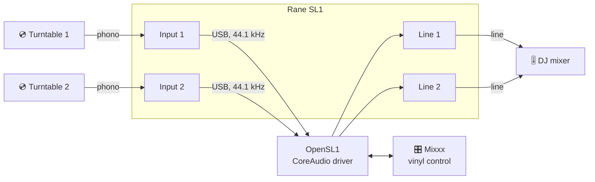

<div align="center">

# 🎛️ OpenSL1

### Your Rane SL1 isn't dead. Scratch with timecode vinyl on Apple Silicon – in Mixxx.

A free, open-source CoreAudio driver for the **Rane SL1** (Serato Scratch Live, 2004),
written from scratch for Macs where no vendor driver runs any more.

[](https://github.com/OnSerious/OpenSL1/releases/latest)
[](https://github.com/OnSerious/OpenSL1/actions/workflows/build.yml)
[](LICENSE)


[](https://mixxx.org)

**[⬇️ Download](https://github.com/OnSerious/OpenSL1/releases/latest)** ·
**[🚀 Quick start](#-quick-start)** ·
**[🎚️ Mixxx setup](#mixxx-setup)** ·
**[🎤 Gig checklist](#-gig-checklist)** ·
**[🇩🇪 Deutsch](README.de.md)**

</div>

---

## ✨ Why

The SL1 was built for Serato Scratch Live, whose last versions are 32-bit Intel software – they cannot run on an
Apple Silicon Mac, not even through Rosetta. The hardware itself is fine: underneath it is a plain USB audio
interface. OpenSL1 talks to it directly and hands it to macOS as a normal sound card, so
[Mixxx](https://mixxx.org) can read your Serato control vinyl again.

## 🎯 Highlights

- 🎧 **Plug in, pick “Rane SL1”** – 4 inputs (Input 1/2) and 4 outputs (Line 1/2) at 44.1 kHz in every CoreAudio app
- 💿 **Serato CV02 timecode on both decks**, tested in Mixxx with real turntables and an external mixer
- 🔌 **Survives the real world** – unplug and replug into any port, sleep and wake, most USB drop-outs: audio comes
  back by itself, Mixxx keeps running
- ⚡ **2.9 ms hardware round trip**, about 35 ms from record to line out with a 5.8 ms buffer
- 🩺 **Gig diagnostics built in** – input levels, gaps, USB errors and power-source changes in the system log
- 🛡️ **User-space only** – no kernel extension, runs inside Apple's audio-server sandbox
- 🧼 **Clean room** – no Rane or Serato code, based on our own measurements of the device

## 🔊 How the signal flows



## 🚀 Quick start

1. **Download** [`OpenSL1-0.1.0.pkg`](https://github.com/OnSerious/OpenSL1/releases/latest) and open it
   (macOS 12 or later, Apple Silicon or Intel).
2. If macOS blocks it: *System Settings → Privacy & Security → **Open Anyway***. The package is ad-hoc signed only –
   there is no paid Apple Developer ID behind this hobby project.
3. **Plug in the SL1**, start Mixxx and follow the [Mixxx setup](#mixxx-setup) below.

To remove it, open `OpenSL1-Uninstall-0.1.0.pkg` (or run `sudo packaging/uninstall.sh`).

## Mixxx setup

| Where in Mixxx | Setting |
|---|---|
| macOS prompt “Mixxx would like to access the microphone” | **Allow** – otherwise there is no timecode |
| Sound Hardware → Sound API / sample rate / buffer | **CoreAudio**, **44100 Hz**, 5.8 ms |
| Sound Hardware → Output → Deck 1 / Deck 2 | “Rane SL1” channels **1–2** / **3–4** |
| Sound Hardware → Output → Main, Headphones | **None** (the DJ mixer does that job) |
| Sound Hardware → Input → Vinyl Control 1 / 2 | “Rane SL1” channels **1–2** / **3–4** |
| Vinyl Control → vinyl type / speed | **Serato CV02 Vinyl, Side A**, 33⅓ RPM |
| Vinyl Control → mode | **REL** |
| Vinyl Control → filter | **Alpha-beta** for scratching |

> [!TIP]
> **Alpha-beta vs. Kalman:** with the Kalman filter the track kept running in slow motion for a moment after stopping
> the record by hand. Alpha-beta stops at once; only the tempo display jitters a little, you don't hear it.

> [!IMPORTANT]
> **Only one sound card.** Do not route Main or Headphones to the Mac's built-in speakers or another interface. Mixxx
> then uses the other device as clock reference and has to match two clocks, which can cause crackles and skips. The
> Mixxx log shows it as `Using "…" as output sound device clock reference`.

Stay at 44.1 kHz – the SL1 runs at 44.1 kHz only, and Mixxx is reported to read timecode slower at 48 kHz.

## 🎤 Gig checklist

- [ ] SL1 plugged in **before** starting Mixxx
- [ ] Mac charger plugged in **before** the set – and left alone during it
      ([why](docs/MACOS.md#known-issue-the-sl1-drops-off-usb-when-the-macs-power-source-changes))
- [ ] Main and Headphones set to **None**, buffer 5.8 ms
- [ ] After Mixxx starts, wait a few seconds before dropping the needle (the SL1's inputs carry a short burst of
      noise right after the stream starts)
- [ ] Don't change sound settings during the set
- [ ] Cable came out? **Keep Mixxx running** and plug the SL1 back in – any port works, sound returns by itself

## 📊 Status

| Feature | | Notes |
|---|:---:|---|
| Timecode on Deck 1 + 2 (Serato CV02) | ✅ | 0 USB errors, no gaps in the timecode |
| Line 1 + 2 output | ✅ | |
| Unplug / replug during playback (any port) | ✅ | sound back ~0.3 s after macOS sees the SL1 again |
| Sleep / wake | ✅ | sound back 45 ms after wake |
| Mac charger plugged in or out | ⚠️ | mostly ≤ 3 s of silence; occasionally the SL1 must be replugged |
| App started while the SL1 is missing | ⚠️ | the app does not pick it up by itself – restart its audio |
| Microphone input | ➖ | not exposed |
| Linux | ✅ | needs no OpenSL1: kernel `snd-usb-audio` (≥ 6.0) supports the SL1, Mixxx uses ALSA |

### Measured on the test system

| | |
|---|---|
| Hardware loop (USB + converters + input stage) | **128 frames = 2.9 ms** (identical in every run) |
| Record → line out, 5.8 ms buffer | **≈ 35 ms** |
| Timecode level / noise floor | −47 dBFS / −88 dBFS (≈ 41 dB signal-to-noise) |
| 15 min of timecode on both decks | 917 434 packets per input, **0 errors, 0 restarts** |

## 🛠️ Troubleshooting

<details>
<summary><b>No “Rane SL1” device</b></summary>

Check the cable, then restart the audio service: `sudo killall coreaudiod`.
</details>

<details>
<summary><b>Silence after the Mac's charger was plugged in or out</b></summary>

The bus-powered SL1 can fall off USB when the Mac's power source changes. Usually the driver recovers within about
3 seconds; if the SL1 hangs, unplug and replug it (Mixxx can keep running). Details:
[docs/MACOS.md](docs/MACOS.md#known-issue-the-sl1-drops-off-usb-when-the-macs-power-source-changes).
</details>

<details>
<summary><b>Mixxx 2.6.0-beta freezes when applying sound settings</b></summary>

A deadlock inside Mixxx/PortAudio: the settings dialog waits for the audio thread while the audio thread waits for
the dialog. The driver keeps running. Force-quit and restart Mixxx; change sound settings before a set or use a
stable Mixxx release.
</details>

<details>
<summary><b>Silence while a test tool is running</b></summary>

Only one program can own the SL1. Quit `sl1rec`/`sl1tone` – they are not needed to play.
</details>

<details>
<summary><b>Audio apps hang after many audio-service restarts</b></summary>

`sudo killall -9 AirPlayXPCHelper` (reported by the OpenSL3 project for the same kind of driver).
</details>

<details>
<summary><b>What happened during my set?</b></summary>

The driver logs statistics every 30 s – packets, USB errors, restarts, input levels, gaps, power-source changes:

```sh
/usr/bin/log show --last 2h --predicate 'subsystem == "org.opensl1.driver"'
```

(In zsh `log` is a shell builtin – use `/usr/bin/log`.)
</details>

## 🧠 How it works

The SL1 turned out to be a standard USB Audio 1.0 device behind a vendor-specific class: 16-bit stereo at 44.1 kHz,
isochronous, one packet per millisecond, and **no control requests needed** – select the interfaces' alternate
setting and stream. See [`docs/PROTOCOL.md`](docs/PROTOCOL.md) for the measurements.

<details>
<summary><b>Driver design in a nutshell</b></summary>

- **AudioServerPlugIn** in user space (`driver/`), USB through **IOUSBHost** (`src/sl1_usb_mac.m`). libusb's macOS
  path triggered a kernel panic with the SL1 on macOS 27, so it is not used there.
- The **clock comes from the SL1's own sample stream** (USB frame numbers + packet sizes), so CoreAudio follows the
  hardware and nothing drifts.
- **Watchdog:** 300 ms without data → reopen the SL1 on the same timeline. If it comes back half-configured or stops
  answering, the driver resets it on the bus.
- **No stale input:** missing data reads as silence, never as old timecode.
- **Never the default device**, so system sounds can't end up on your PA.

More in [`docs/MACOS.md`](docs/MACOS.md).
</details>

## 🧰 Build & test

<details>
<summary><b>Build from source</b></summary>

Needs a C compiler and `make`; on macOS the Xcode Command Line Tools (`xcode-select --install`).

```sh
make            # tools: build/sl1probe, build/sl1rec, build/sl1tone; unit tests: build/test_core
make test       # unit tests, no hardware needed
make driver     # macOS: build/OpenSL1.driver (universal), build/hal_harness, build/ca_check, build/ca_loop
make pkg        # macOS: build/OpenSL1-<version>.pkg and build/OpenSL1-Uninstall-<version>.pkg
```

- `sl1probe` and the Linux backend use libusb: `brew install libusb pkg-config` or
  `apt install libusb-1.0-0-dev pkg-config`.
- On macOS `sl1rec`/`sl1tone` use IOUSBHost automatically. **Do not force `USB_BACKEND=libusb` on macOS.**
- Developer install without the package: `sudo make install-driver` / `sudo make uninstall-driver`.
- Signed release: `make pkg SIGN_ID="Developer ID Application: …" PKG_SIGN_ID="Developer ID Installer: …"`, then
  notarize with `xcrun notarytool`.
</details>

<details>
<summary><b>Test tools</b></summary>

```sh
build/hal_harness -d 10   # loads the driver in-process and drives it like the HAL (no install)
build/ca_check -d 6       # tests the installed driver through CoreAudio, like an app
build/ca_loop -t -50      # round-trip latency; cable Line 1 left → Input 1 left (phono level: stay quiet!)
build/sl1probe            # read-only: interfaces, endpoints, formats
build/sl1rec -i A -d 5 -o deckA.wav     # record Input 1 (A, B or mic)
build/sl1tone -o A -f 440 -l -12 -d 5   # test tone on Line 1 (A or B)
```

The tools need exclusive access to the SL1, so quit Mixxx first. On Linux, install the udev rule once:

```sh
sudo cp udev/50-opensl1.rules /etc/udev/rules.d/
sudo udevadm control --reload && sudo udevadm trigger
```
</details>

<details>
<summary><b>Repository layout</b></summary>

```
src/sl1_proto.h    device constants (from our own measurements)
src/sl1_pkt.*      44.1 kHz → 1 ms packets (44/45 frames)
src/sl1_ring.*     lock-free single-producer/single-consumer ring buffer
src/sl1_usb.*      libusb backend (Linux), shared API in sl1_usb.h
src/sl1_usb_mac.m  IOUSBHost backend (macOS)
src/wav.*          WAV writer for tests
driver/            CoreAudio AudioServerPlugIn + Info.plist
packaging/         installer/uninstaller (pkgbuild/productbuild), uninstall.sh
tools/             sl1probe, sl1rec, sl1tone
tests/             unit tests, hal_harness, ca_check, ca_loop
docs/              PROTOCOL.md, MACOS.md, usb-descriptors.txt
udev/              access rule for Linux
```
</details>

## 🧪 Tested with

| | |
|---|---|
| Interface | Rane SL1 (`13e5:0001`) via a passive USB-A → USB-C adapter |
| Mac | MacBook Air 13-inch, M4, 2025 (`Mac16,12`, 10 cores, 16 GB) |
| macOS | 27.0.1 (26A434) |
| DJ software | Mixxx 2.6.0-beta |
| Vinyl / mixer | Serato CV02 control vinyl, two turntables, external Pioneer mixer |
| Linux (no OpenSL1 needed) | CachyOS, kernel 7.2, Mixxx 2.5.6 |

Tried it on another Mac? Please open an issue with your model, macOS version and the log lines above – reports are
very welcome.

## 🤝 Contributing & clean-room policy

Contributions must be based on public documentation and on measurements of the hardware (descriptors, USB captures,
audio tests). **Do not submit code, binaries or disassembly from Rane/Serato software.** OpenSL1 does not make the SL1
pose as other hardware and does not bypass any licence check; it publishes the SL1 under its own identity
(USB `13e5:0001`, model UID `OpenSL1:13e5:0001`).

## 🙏 Acknowledgements

- [**OpenSL3**](https://github.com/mrbrainz/OpenSL3) by mrbrainz showed that a user-space AudioServerPlugIn with
  IOUSBHost works for Rane hardware on Apple Silicon. OpenSL1 is written from scratch – no OpenSL3 code is included –
  but several robustness ideas come from its changelog (keeping the device through an unplug, filtering owned
  objects, no notifications from StartIO/StopIO, building for older macOS versions).
- [**libusb**](https://libusb.info) (LGPL-2.1) is used by the Linux backend and `sl1probe`; it is linked, not
  included.
- [**Mixxx**](https://mixxx.org) and its xwax-based vinyl control make all of this useful.

## 📜 License & disclaimer

**GPL-3.0-or-later** – see [`LICENSE`](LICENSE). Every source file carries `SPDX-License-Identifier: GPL-3.0-or-later`.

OpenSL1 is an independent project and is **not affiliated with, endorsed by or supported by Rane, Serato or
inMusic**. Rane, SL1, Serato and Scratch Live are trademarks of their respective owners and are used here only to name
the hardware this driver works with. It contains no code or files from Rane or Serato.

<div align="center">

Made for DJs who keep their gear alive. 🎛️💿

</div>
