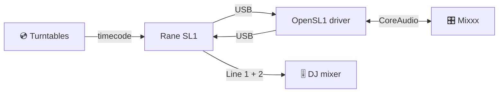

<div align="center">

# 🎛️ OpenSL1

## The missing macOS driver for the Rane SL1

**Bring your Serato Scratch Live box back to life on Apple Silicon – and scratch timecode vinyl in Mixxx.**

   

<a href="https://github.com/OnSerious/OpenSL1/releases/latest"></a> <a href="https://github.com/OnSerious/OpenSL1/actions/workflows/build.yml"></a> <a href="LICENSE"></a> 

### [⬇️ Download the installer](https://github.com/OnSerious/OpenSL1/releases/latest)


<a href="https://ko-fi.com/OnSerious"></a>

</div>

<p align="center">
🇺🇸 <a href="./README.md">English</a> | 🇩🇪 <a href="./README.de.md">Deutsch</a>
</p>

---

<details open>
<summary><b>📑 Contents</b></summary>

- [Why OpenSL1?](#-why-opensl1)
- [Features](#-features)
- [How it works](#-how-it-works)
- [Requirements](#-requirements)
- [Installation](#-installation)
- [Mixxx setup](#mixxx-setup)
- [Gig checklist](#-gig-checklist)
- [Performance](#-performance)
- [FAQ](#-faq)
- [Troubleshooting](#-troubleshooting)
- [Roadmap](#-roadmap)
- [Contributing](#-contributing)
- [License & disclaimer](#-license--disclaimer)

</details>

## 💡 Why OpenSL1?

> [!NOTE]
> **Which box is this?** The original Rane interface for **Serato Scratch Live** from 2004 – a small box with
> Input 1/2, Thru and Line jacks for two decks. It just said “Serato Scratch Live” on it; the name **SL1** only came
> later, when the SL2 and SL3 appeared. On USB it reports itself as `Serato Scratch LIVE(c)2004` (`13e5:0001`).

Your SL1 still works. The software behind it doesn't: Serato Scratch Live is 32-bit Intel software, and Apple Silicon
Macs can't run it – not even through Rosetta. Serato DJ never supported the SL1 at all.

**OpenSL1 is a native macOS audio driver for the SL1.** Install it, plug in the box, and it shows up as a regular
sound card called **“Rane SL1”** – ready for [Mixxx](https://mixxx.org), the free DJ software that reads Serato
control vinyl.

> [!NOTE]
> OpenSL1 is an independent open-source project. It is **not** made, endorsed or supported by Rane, Serato or inMusic,
> and it contains no code from them.

## ✨ Features

| | |
|---|---|
| 🎧 **Plug & play** | “Rane SL1” with 4 inputs (Input 1/2) and 4 outputs (Line 1/2) at 44.1 kHz |
| 💿 **Timecode on both decks** | Serato CV02 control vinyl in Mixxx, tested with real turntables and a DJ mixer |
| 🔌 **Built for accidents** | Cable pulled mid-set? Plug it back into *any* port – the music returns on its own |
| 🧷 **Never loses your setup** | “Rane SL1” stays available even when the box is unplugged – start Mixxx first, plug in later |
| 😴 **Sleep-proof** | Close the lid, open it again – sound is back 45 ms after wake |
| ⚡ **Fast hardware path** | 2.9 ms through USB and converters |
| 🩺 **Gig diagnostics** | Levels, gaps, USB errors and power events in the macOS log – see what happened during your set |
| 🛡️ **Safe by design** | No kernel extension; runs inside Apple's audio-server sandbox and never becomes your system output |
| 🍏 **Universal** | One installer for Apple Silicon and Intel, macOS 12 Monterey and later |

## 🔊 How it works

<!-- Experimental: if rendering fails, preview on GitHub -->


The SL1 is a USB audio interface underneath: OpenSL1 streams its inputs and outputs directly over USB and presents
them to macOS as a CoreAudio device. The audio clock comes from the SL1 itself, so nothing drifts.

## 📋 Requirements

| | |
|---|---|
| 💻 Mac | Apple Silicon (M1 and later) or Intel |
| 🍏 macOS | 12 Monterey or later |
| 🎛️ Interface | Rane SL1 |
| 🎚️ DJ software | [Mixxx](https://mixxx.org) (free) |
| 💿 Control vinyl | Serato CV02 (Side A, 33⅓ RPM) |

## 📦 Installation

1. Download **`OpenSL1-0.1.1.pkg`** from the [latest release](https://github.com/OnSerious/OpenSL1/releases/latest).
2. Double-click it and follow the installer.
3. Plug in the SL1 – done. It appears as **“Rane SL1”** in *Audio MIDI Setup* and in Mixxx.

> [!IMPORTANT]
> The installer is not notarized by Apple (this is a free hobby project without a paid developer account).
> If macOS refuses to open it, go to **System Settings → Privacy & Security** and click **Open Anyway**.

<details>
<summary><b>🗑️ Uninstall</b></summary>

Open **`OpenSL1-Uninstall-0.1.1.pkg`** from the same release. That's it.
</details>

## Mixxx setup

| Where | Setting |
|---|---|
| macOS asks “Mixxx would like to access the microphone” | **Allow** – otherwise no timecode reaches Mixxx |
| Preferences → Sound Hardware | **CoreAudio**, **44100 Hz**, buffer **5.8 ms** |
| Output: Deck 1 / Deck 2 | “Rane SL1” channels **1–2** / **3–4** |
| Output: Main, Headphones | **None** – your DJ mixer does that |
| Input: Vinyl Control 1 / 2 | “Rane SL1” channels **1–2** / **3–4** |
| Preferences → Vinyl Control | **Serato CV02 Vinyl, Side A**, 33⅓ RPM, mode **REL** |
| Vinyl Control → filter | **Alpha-beta** for scratching |

> [!TIP]
> **Alpha-beta beats Kalman for scratching.** With the Kalman filter the track keeps running in slow motion for a
> moment after you stop the record with your hand. Alpha-beta stops instantly – only the tempo display wiggles a bit,
> you won't hear it.

> [!WARNING]
> **Use the SL1 as your only sound card in Mixxx.** If Main or Headphones go to the Mac's speakers or another
> interface, Mixxx has to sync two clocks – that can cause crackles and skips.

## 🎤 Gig checklist

- [ ] Plug the Mac's charger in **before** the set – and don't touch it during the set
- [ ] Main and Headphones set to **None**, buffer 5.8 ms, 44.1 kHz
- [ ] After plugging in or starting Mixxx, give the SL1 a second or two before you drop the needle
- [ ] Don't change sound settings mid-set
- [ ] Cable came out? **Keep Mixxx running** and plug the SL1 back in – any port

## 📊 Performance

Measured on a MacBook Air M4 with real timecode:

| | |
|---|---|
| ⚡ Hardware loop (USB + converters) | **2.9 ms** – identical in every run |
| 🎚️ Record → line out (5.8 ms buffer) | **≈ 35 ms** |
| 🔇 Signal-to-noise on the inputs | **≈ 41 dB** (timecode −47 dBFS, noise floor −88 dBFS) |
| ✅ 15 min of timecode on both decks | **917 434 packets per input, 0 errors** |
| 🔌 Replug during playback | sound back **0.3 s** after macOS sees the SL1 |
| 😴 Wake from sleep | sound back **45 ms** after wake |

## ❓ FAQ

<details>
<summary><b>Does this make the SL1 work with Serato DJ?</b></summary>

No. Serato DJ never supported the SL1, and OpenSL1 will never pretend the SL1 is a different device. Use Mixxx.
</details>

<details>
<summary><b>Can I use it with other apps?</b></summary>

The SL1 is a normal CoreAudio device, so other apps can use it as a sound card. **VirtualDJ** (macOS) opens it,
plays to Line 1/2 and survives changing its audio settings; its timecode (DVS) feature needs a paid VirtualDJ licence
and has not been tested yet. Timecode control is tested with Mixxx.
</details>

<details>
<summary><b>Does it work on Intel Macs?</b></summary>

The installer contains a universal driver (Apple Silicon + Intel). It has been tested on Apple Silicon only – reports
from Intel Macs are welcome.
</details>

<details>
<summary><b>Is it safe?</b></summary>

OpenSL1 is a user-space audio plug-in, not a kernel extension. It runs inside macOS's sandboxed audio service with
access to the SL1 only – no files, no network. The full source is in this repository.
</details>

<details>
<summary><b>What about the microphone input?</b></summary>

Not supported yet.
</details>

<details>
<summary><b>I'm on Linux.</b></summary>

You don't need OpenSL1 – Linux supports the SL1 out of the box. See [docs/DEVELOPMENT.md](docs/DEVELOPMENT.md#linux).
</details>

## 🔧 Troubleshooting

<details>
<summary><b>No “Rane SL1” device</b></summary>

Check the cable, then restart the audio service in Terminal: `sudo killall coreaudiod`.
</details>

<details>
<summary><b>Sound drops when I plug the Mac's charger in or out</b></summary>

The SL1 gets its power over USB and can briefly drop off when the Mac switches between charger and battery. The driver
usually recovers within about 3 seconds. Occasionally the SL1 hangs – unplug it and plug it back in, Mixxx can keep
running. Best practice: plug the charger in before the set. Details in
[docs/MACOS.md](docs/MACOS.md#known-issue-the-sl1-drops-off-usb-when-the-macs-power-source-changes).
</details>

<details>
<summary><b>I started Mixxx before plugging in the SL1</b></summary>

No problem since 0.1.1: “Rane SL1” stays available even when the box is unplugged, so Mixxx keeps its setup and
starts normally (silent). Plug in the SL1 – the sound comes within a second, no click needed.
</details>

<details>
<summary><b>Mixxx 2.6 beta freezes when I apply sound settings</b></summary>

Seen with Mixxx 2.6.0-beta and the SL1 (not with the Mac's built-in audio): the freeze is a deadlock between two
Mixxx threads while it stops the stream; the driver keeps running. We are still narrowing down the trigger. Until
then: force-quit and restart Mixxx, and set up sound before your set.
</details>

<details>
<summary><b>What happened during my set?</b></summary>

The driver writes a short report every 30 seconds. In Terminal:

```bash
/usr/bin/log show --last 2h --predicate 'subsystem == "org.opensl1.driver"'
```
</details>

## 🧭 Roadmap

- [x] CoreAudio driver with timecode on both decks
- [x] Survive unplugging, sleep and USB drop-outs
- [x] Installer and uninstaller
- [x] Keep “Rane SL1” visible even when unplugged, so Mixxx never loses its setup
- [x] Report the measured latency to apps
- [ ] Notarized installer
- [ ] Microphone input

## 🤝 Contributing

Tried OpenSL1 on another Mac or macOS version? **Open an issue** with your Mac model, macOS version and the log
lines above – every report helps. Building from source, test tools and internals:
**[docs/DEVELOPMENT.md](docs/DEVELOPMENT.md)**.

OpenSL1 follows a strict clean-room rule: no code, binaries or disassembly from Rane or Serato software.

## 🙏 Acknowledgements

- [**OpenSL3**](https://github.com/mrbrainz/OpenSL3) by mrbrainz proved that this kind of driver works for Rane gear
  on Apple Silicon. OpenSL1 is written from scratch – no OpenSL3 code is included – but several robustness ideas
  come from its changelog.
- [**Mixxx**](https://mixxx.org) and its xwax-based vinyl control make all of this useful.

<details>
<summary><b>🧪 Tested with</b></summary>

| | |
|---|---|
| Mac | MacBook Air 13-inch, M4, 2025 (`Mac16,12`, 16 GB) |
| macOS | 27.0.1 (26A434) |
| Connection | passive USB-A → USB-C adapter |
| DJ software | Mixxx 2.6.0-beta |
| Vinyl / mixer | Serato CV02, two turntables, Pioneer mixer |
</details>

## 📜 License & disclaimer

**GPL-3.0-or-later** – see [LICENSE](LICENSE).

Rane, SL1, Serato and Scratch Live are trademarks of their respective owners and are used here only to name the
hardware this driver works with. OpenSL1 is not affiliated with, endorsed by or supported by Rane, Serato or inMusic.

<div align="center">

**Made for DJs who keep their gear alive.** 🎛️💿

If OpenSL1 saved your SL1, give it a ⭐

</div>
