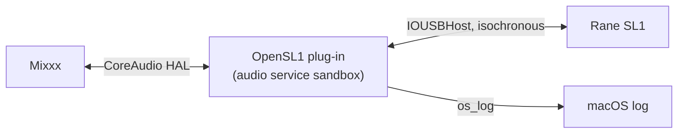

<div align="center">

# 🍏 OpenSL1 on macOS

**How the CoreAudio driver works, how it stays alive during a set, and what can still go wrong.**

  

[← README](../README.md) · [Development](DEVELOPMENT.md) · [USB protocol](PROTOCOL.md)

</div>

---

<details open>
<summary><b>📑 Contents</b></summary>

- [Driver design](#-driver-design)
- [Robustness](#-robustness)
- [Known issue: the SL1 drops off USB when the Mac's power source changes](#known-issue-the-sl1-drops-off-usb-when-the-macs-power-source-changes)
- [Known issue: libusb causes a kernel panic](#known-issue-libusb-causes-a-kernel-panic)
- [Debugging](#-debugging)

</details>

## 🧩 Driver design

`driver/sl1_driver.c` is a CoreAudio **AudioServerPlugIn** – a user-space driver loaded by macOS's audio service. It
publishes one device while an SL1 is plugged in:

| Property | Value |
|---|---|
| Name / manufacturer | “Rane SL1” / “Rane” (model name “SL1 (OpenSL1 driver)”) |
| Device UID | `OpenSL1:13e5:0001:1` – the SL1 has no serial number and only one SL1 is supported, so the UID does not depend on the USB port |
| Model UID | `OpenSL1:13e5:0001` |
| Transport | USB |
| Input stream | 4 ch: Input 1 L/R, Input 2 L/R |
| Output stream | 4 ch: Line 1 L/R, Line 2 L/R |
| Format | 44 100 Hz, 32-bit float (the SL1 itself streams 16-bit) |

<!-- Experimental: if rendering fails, preview on GitHub -->


<details>
<summary><b>🔌 Hot-plug</b></summary>

Since 0.1.1 the device is **always published**, also without an SL1 – an app that starts while the box is
missing keeps its device setup. Without the SL1 (or if it cannot be opened) the driver runs IO on a free-running
clock at the nominal 44.1 kHz: inputs read silence, outputs go nowhere. IOKit matching notifications tell the
watchdog when the SL1 appears; it opens it and continues on the same timeline (measured: sound 0.24–0.34 s after
plug-in, 0 timestamp errors). An unplug during IO works the same way in reverse. The USB interfaces are only opened
while IO is running, so the tools can use the SL1 when no app does.

Trade-off: “Rane SL1” is listed in every app and in Audio MIDI Setup even when nothing is plugged in.
</details>

<details>
<summary><b>🚌 USB</b></summary>

Through `IOUSBHost.framework` (`src/sl1_usb_mac.m`): set configuration 1 if needed, open the streaming interfaces
1/2/4/5/7, select alt 1, schedule isochronous requests of 2 packets at explicit bus frame numbers – 12 requests in
flight per input (24 ms of slack, no extra latency), 6 per output.
</details>

<details>
<summary><b>🛡️ Sandbox</b></summary>

The audio service only lets plug-ins open the IOKit user clients listed in `Info.plist` under
`AudioServerPlugIn_IOKitUserClients`: `AppleUSBHostFrameworkDeviceClient` and `AppleUSBHostFrameworkInterfaceClient`
(class names measured with `ioreg` while the device was open). On macOS 27 the plug-in runs in
`com.apple.audio.Core-Audio-Driver-Service.helper`.
</details>

<details>
<summary><b>⏱️ Clock</b></summary>

The device sample counter is the number of frames received on Input 1. Bus frames map to host time with the nominal
slope (1 ms) and an offset that follows the lower envelope of `frameNumberWithTime:` pairs (each pair is 0–1 ms late
because the frame number is whole), smoothed. Together they give the zero timestamps (period 16 384 frames). Missing
packets and skipped bus frames are filled with silence so the counter never falls behind the clock. Output packets
are sized from the same counter, so the HAL, the input and the output never drift apart.

Measured over 60 s: 44 100.22 Hz, timestamp step error ≤ 27 µs.
</details>

<details>
<summary><b>🧺 Buffers and latency</b></summary>

Both directions use rings indexed by device sample time.

| | Value | Why |
|---|---|---|
| Input safety offset | 397 frames (9 ms) | with 6 ms the real HAL left only 4 frames of headroom |
| Output safety offset | 529 frames (12 ms) | with 16 ms the real HAL left 390 frames unused |
| Measured headroom with Mixxx | input ≥ 254, output ≥ 208 frames | 0 late accesses |
| Hardware loop (USB + converters) | 128 frames (2.9 ms) | measured with `ca_loop`, identical in every run |

The driver logs its headroom on every stop – check it after changing the scheduling constants. The hardware loop is
reported to apps as `kAudioDevicePropertyLatency`: 64 frames input + 64 frames output (the split is unknown).
</details>

> [!NOTE]
> **Never the default device:** `CanBeDefaultDevice` is 0, so macOS never routes system alerts or other apps to the
> SL1 on its own. Apps such as Mixxx select it explicitly.

## 💪 Robustness

| Feature | What it does | Tested |
|---|---|---|
| **Watchdog** | Checks Input 1 every 100 ms; after 300 ms without data (USB glitch, re-plug, wake) it reopens the SL1 and continues on the same timeline – the app keeps running | `OPENSL1_TEST_STALL` in `hal_harness`: 1 restart, 0 timestamp errors; real unplug/replug with Mixxx |
| **Bus reset after a drop-out** | If the SL1 comes back with its interfaces missing, does not answer SET_CONFIGURATION, or (still on the bus) does not answer SET_INTERFACE, the driver re-enumerates it – at most once every 10 s | `OPENSL1_TEST_RESET`: audio back ~0.5 s after the reset; real charger changes |
| **No stale input** | Frames that have not arrived yet (or were overwritten) read as silence, never as old timecode | `OPENSL1_TEST_STALL` |
| **Quiet start/stop** | No `DeviceIsRunning` notifications from StartIO/StopIO – the HAL tracks that itself (OpenSL3 removed them when fixing a busy audio service) | – |
| **OwnedObjects** | Honours the class-ID qualifier (a query for controls returns none, not the streams) | – |
| **Open retry** | StartIO retries opening the SL1 three times | – |
| **Defensive input** | Packet lengths clamped to the endpoint size; property calls check object, size and pointers; the IO thread never blocks | – |

> [!IMPORTANT]
> **Security:** the driver runs inside the audio-service sandbox; its only extra rights are the two IOUSBHost user
> clients. It opens no files and no network connections. The installer writes root-owned files (`0/0`, 755/644).

## Known issue: the SL1 drops off USB when the Mac's power source changes

> [!WARNING]
> Plugging the Mac's charger in or out can make the bus-powered SL1 fall off USB. **Plug the charger in before a set
> and leave it alone.**

The SL1 is bus-powered (300 mA) and dates from USB 1.x. On a MacBook Air (M4, macOS 27) it repeatedly fell off the
bus when the charger was plugged in or unplugged, sometimes only 5–21 s later while running on battery. Observed
with a passive USB-A to USB-C adapter (25 Oct 2026):

| Case | What happened |
|---|---|
| ✅ Most drop-outs with audio running | The SL1 comes back, the driver resets it, the app keeps playing – at most ~3 s of silence, no click in Mixxx (9 of 10 charger changes) |
| ⚠️ Occasionally | The SL1 hangs: it no longer answers control requests and does not come back after a reset – only unplugging and replugging helps |
| ⚠️ macOS accessory prompt | After a drop-out macOS may ask whether to allow the accessory; while it is open, or even after allowing, the SL1 may stay incomplete until it is replugged |

<details>
<summary><b>🔍 What we can and cannot see</b></summary>

The system did not sleep, Low Power Mode was off, and audio held a sleep assertion. macOS exposes no voltage or
current for the port (only its 3 A limit). The SL1 drops off about 1 s *before* macOS reports the new power source.
Why the port drops the SL1 – power-role renegotiation, a voltage dip, or port power management on battery – is
unconfirmed.
</details>

**Recommendations for a gig:**

- [ ] Plug the charger in before the set and do not touch it during the set
- [ ] Prefer a direct USB-C to USB-B cable over a USB-A to USB-C adapter (one contact less – untested)
- [ ] A powered USB hub between the Mac and the SL1 may isolate it from the port's power changes (untested)
- [ ] The SL1's optional 9 V supply jack should make the box independent of the Mac's USB power and probably avoids the drop-outs – untested, no promise

## Known issue: libusb causes a kernel panic

> [!CAUTION]
> Do not build the tools with `USB_BACKEND=libusb` on macOS. OpenSL1 uses IOUSBHost there.

On macOS 27.0.1 (26A434, Apple M4), `sl1rec` built with libusb 1.0.30 panicked the kernel 1.5 s after start:
“Kernel data abort” at address 0x3 in `com.apple.iokit.IOUSBHostFamily`. The user-space stack, resolved with `atos`:

```
libusb_set_interface_alt_setting → darwin_set_interface_altsetting → get_endpoints
  → darwin_get_pipe_properties → IOKit → kernel
```

It happened while switching interface 2 to alt 1 and reading the pipe properties through the legacy IOUSBLib
interface. A user process must never be able to panic the kernel, so this is a macOS bug. The SL1's unusual
descriptors (vendor class with UAC1 descriptors, 9-byte endpoint descriptors) are a plausible trigger, but this is
unconfirmed. The IOUSBHost path used by OpenSL1 has not shown the problem. `sl1probe` only reads descriptors through
libusb and is safe.

## 🩺 Debugging

The driver writes to the unified log (subsystem `org.opensl1.driver`). In zsh `log` is a shell builtin – use
`/usr/bin/log`:

```bash
/usr/bin/log show --last 2h --predicate 'subsystem == "org.opensl1.driver"'   # after a gig
/usr/bin/log stream --predicate 'subsystem == "org.opensl1.driver"'           # live
```

| Log line | Every | Tells you |
|---|---|---|
| `stats` | 30 s and on stop | packets, USB errors, audible frames, clock rate, restarts |
| `headroom` | 30 s and on stop | input/output safety margin, late accesses |
| `input 1/2` | 30 s | RMS/peak per channel, clipping, L/R correlation (timecode ≈ 0), gaps, resyncs |
| `power …` | on change | charger or battery, adapter watts – match it against `SL1 removed` |
| `SL1 attached/removed`, `IO restarted` | on event | hot-plug and watchdog activity |

More tools and test hooks: [DEVELOPMENT.md](DEVELOPMENT.md).
