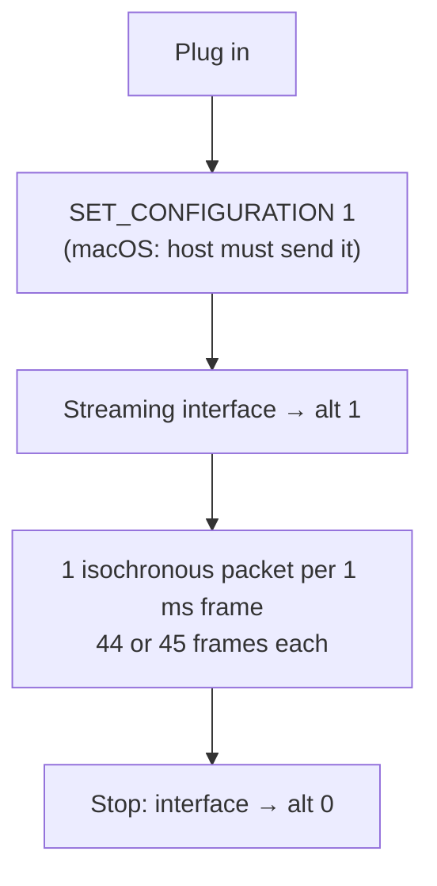

# 🔬 Rane SL1 – USB protocol

**Everything we know about the SL1 on the wire – from our own measurements, no vendor code involved.**

  

[← README](../README.md) · [macOS driver](MACOS.md) · [Development](DEVELOPMENT.md)

---

> [!NOTE]
> **Sources:** measurements of a Rane SL1 on Linux 7.2 (`lsusb -v`, ALSA stream info, capture and playback tests)
> and on macOS 27 / Apple M4 (IOUSBHost, `sl1probe`, `sl1rec`, `sl1tone`, the CoreAudio driver, `ca_loop`). Raw
> descriptors: [`usb-descriptors.txt`](usb-descriptors.txt). Last updated 2026-10-25.

## 🧾 TL;DR

The SL1 is a **standard USB Audio 1.0 device hiding behind a vendor-specific class**. Set configuration 1, switch the
streaming interfaces to alternate setting 1, stream 16-bit stereo at 44.1 kHz – **no control requests needed.**

## 📟 Device

| | |
|---|---|
| VID / PID | `13e5:0001` |
| Manufacturer / product strings | “Serato” / “Serato Scratch LIVE(c)2004” |
| Serial number | none (`iSerial 0`) |
| USB | 1.0, **full speed** (12 Mbit/s), bMaxPacketSize0 32 |
| Power | bus powered, 300 mA (9 V supply optional) |
| Class | 0xFF (vendor), one configuration (value 1), 9 interfaces |

## 🧱 Structure

Internally a **USB Audio Class 1.0 device with a vendor-specific class**: every interface reports class 0xFF but carries
standard UAC1 class-specific descriptors (type 0x24). Subclass 1 = Audio Control, subclass 2 = Audio Streaming.
Endpoint descriptors are 9 bytes long (UAC1 style, with bRefresh/bSynchAddress). Because of the vendor class no
standard driver binds automatically (Linux uses a quirk entry).

| Interface | Function | Endpoint (alt 1) | Format |
|:---:|---|---|---|
| 0 | Audio Control, deck A | – | – |
| 1 | 🔊 Playback deck A → **Line 1** | `0x01` OUT, isochronous, adaptive, max 184 B, 1 ms | PCM S16LE, 2 ch |
| 2 | 🎙️ Capture deck A ← **Input 1** | `0x82` IN, isochronous, adaptive, max 184 B, 1 ms | PCM S16LE, 2 ch |
| 3 | Audio Control, deck B | – | – |
| 4 | 🔊 Playback deck B → **Line 2** | `0x04` OUT, isochronous, adaptive, max 184 B | PCM S16LE, 2 ch |
| 5 | 🎙️ Capture deck B ← **Input 2** | `0x84` IN, isochronous, adaptive, max 184 B | PCM S16LE, 2 ch |
| 6 | Audio Control, microphone | – | – |
| 7 | 🎤 Capture microphone | `0x85` IN, isochronous, adaptive, max 144 B | PCM S16LE, 1 ch |
| 8 | ❔ Control channel (HID-like, class 0xFF) | `0x83` IN + `0x03` OUT, interrupt, 64 B, 4 ms | 28-byte report descriptor, purpose unknown |

Interface string descriptors as seen by macOS: “Line 1”, “LineOut1Idle”, “LineIn1Idle”, “Line 2”, “LineOut2Idle”,
“LineIn2Idle”, “Mic”, “MicIdle” (interfaces 0–7).

Sample rates in the format descriptor: 32 000 and 44 100 Hz. There is no class-specific endpoint descriptor (no
sampling frequency control). Only 44 100 Hz has been tested, without a rate request.

## ▶️ Operation (confirmed)

<!-- Experimental: if rendering fails, preview on GitHub -->

1. **Set configuration 1.** Linux does this on plug-in; macOS leaves the device unconfigured, so the host must send
   SET_CONFIGURATION itself.
2. **Switch a streaming interface to alternate setting 1** to activate its endpoint. Alt 0 = idle.
3. **One isochronous packet per 1 ms frame.** At 44.1 kHz a packet carries 44 or 45 frames (176/180 bytes stereo).
   Output is adaptive: the host chooses the packet size (pattern 9 × 44 + 1 × 45 per 10 ms on average).
4. **No other request is needed.** Capture and playback work without requests on interface 8 and without
   class-specific control requests.

> [!TIP]
> The input rate follows the USB frame clock: over 10 s the SL1 delivered 44.1000–44.1002 frames per 1 ms frame
> (measured on macOS). The CoreAudio driver uses the received input frame count as the device clock and sizes the
> output packets from it.

## 📏 Measurements

| What | Result |
|---|---|
| Timecode on Input 1/2 (Serato CV02) | carrier 1000–1006 Hz, L/R 90° apart (correlation ≈ 0), RMS ≈ −47 dBFS, peaks −35 dBFS (≈ −28 dBFS when scratching) |
| Idle inputs | about −88 to −92 dBFS |
| Hardware loop Line 1 → Input 1 (USB + converters + input stage) | **128 frames = 2.9 ms**, identical across runs |
| Line outputs | a −12 dBFS test tone needs about +9 dB trim on a Pioneer mixer for 0 dB – normal, slightly low line level |
| Inputs | phono level, no phono/line switch on the box (a loopback test from Line 1 worked at −50 dBFS) |

## ✅ Confirmed tests

- [x] Capture of Input 1 with Serato CV02 timecode (Linux and macOS)
- [x] Playback: a test tone on Line 1 and Line 2 arrives separately at the mixer (Line 1 → channel 1, Line 2 → channel 2)
- [x] Mixxx with vinyl control on both decks – Linux (2.5.6, ALSA) and macOS (2.6.0-beta, OpenSL1)
- [x] macOS: Input 1, Input 2, Mic, Line 1 and Line 2 streamed through IOUSBHost with 0 packet errors

## ❓ Open questions

- [ ] Purpose of interface 8 (interrupt channel): status/LEDs? Not needed for audio.
- [ ] Whether 32 kHz needs a request.
- [ ] Microphone: packets of 42–72 frames were seen (expected 44/45 for mono 44.1 kHz); the format needs a closer
      look. Gain is analog only (“Mic Gain” knob).
- [ ] Behaviour without the 9 V supply under long use.
- [ ] **Start-up burst:** right after a stream starts, all four input channels carry the same impulsive noise for a
      few seconds (RMS ≈ −52 dBFS, peaks −26.5 dBFS, L/R correlation 1.0), then the inputs settle to about −88 dBFS.
      Seen on macOS. Cause unknown – wait a few seconds before dropping the needle.
